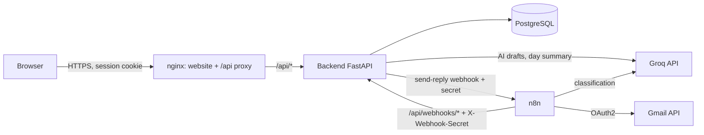

# Report: Inbox Assistant (Web, API and n8n automation)

## 1. Installation from an empty repository

See [README.md](README.md) for the full steps. In short:

```bash
git clone <repo> && cd inbox-assistant
cp .env.example .env                       # fill in the secrets
docker compose up -d --build               # db + backend + web + n8n
docker compose exec backend python -m scripts.seed --classify   # 30 demo emails
# http://localhost:8080
```

Then, to go live: Groq key, Gmail OAuth client, `python n8n/setup_n8n.py`, sign in to Google in n8n, activate the workflows (README, "Going live").

## 2. Architecture



Rules:
- **The website never calls n8n.** It only calls `/api/*` on its own origin. nginx blocks `/api/webhooks/*` from the outside: only n8n reaches those routes, on the internal Docker network.
- **n8n never writes to the database.** It calls the backend, which validates everything.
- **Each direction has its own secret:** `WEBHOOK_SECRET` (n8n to backend) and `N8N_WEBHOOK_SECRET` (backend to n8n).

### The four workflows

| Workflow | Trigger | What it does |
|---|---|---|
| 1. Gmail sync | Every 10 min | Gets the cursor from the backend, lists Gmail with `after:<cursor>` (all pages), fetches each message (10 per second), parses it, posts batches of 20, closes the sync run |
| 2. AI classification | Every 5 min | Gets pending emails with a ready-made prompt, calls Groq, posts the raw answer for validation, retries once if invalid, pauses 3 s between emails |
| 3. Send reply | Webhook, called by the backend | Claims the attempt, builds the MIME message (same Gmail thread), sends it, reports `sent` or `failed` |
| 4. Error handler | Error Trigger | Records any crash in the backend; a crashed sync run is marked failed |

### Main flows

**Sync.** The cursor is the *start* time of the last *successful* run, minus a 5-minute overlap. Emails that arrive during a run, or a small clock difference, are therefore fetched again next time, and the duplicates are dropped by the unique Gmail id. A failed or crashed run never moves the cursor, so nothing is lost. The first sync ever only fetches the last 30 days.

**Classification.** The backend builds the prompt (with phone numbers and IBANs masked), n8n forwards it to Groq and sends back the raw text. The backend validates it with a strict schema:
- Valid: saved.
- Invalid: the backend returns a stricter prompt and n8n retries once.
- Invalid again: category `other`, flag `needs_review` ("To verify" in the UI).
- Groq unreachable after its retries: the email simply stays pending for the next run, so a quota problem is never mistaken for a bad answer.

**Reply.** The user sees and edits the draft, clicks *Review and send*, then *Send now*. The front end creates one `Idempotency-Key` per confirmation. The backend stores the reply (unique key), then hands it to n8n in a background task. n8n must **claim** the attempt before sending. The UI polls the reply status (sending, sent, or failed with a Retry button).

## 3. Data model

```mermaid
erDiagram
    users ||--o{ auth_sessions : has
    threads ||--o{ emails : contains
    emails ||--o{ drafts : has
    emails ||--o{ replies : has
    drafts |o--o{ replies : "used for"

    users { int id PK; string email UK; string password_hash }
    auth_sessions { int id PK; string token_hash UK; int user_id FK; datetime expires_at }
    threads { int id PK; string gmail_thread_id UK; string subject; datetime last_message_at }
    emails { int id PK; string gmail_message_id UK; int thread_id FK; string rfc822_message_id; string from_address; json to_addresses; string subject; text body_text; datetime received_at; bool is_outbound; string status; string category; int priority; text ai_summary; text expected_action; bool needs_review; string classification_state; int classification_attempts; bool first_try_valid }
    drafts { int id PK; int email_id FK; string tone; text body; string model }
    replies { int id PK; int email_id FK; int draft_id FK; string idempotency_key UK; text body; string status; int attempts; int claimed_attempt; string gmail_message_id; text error }
    sync_runs { int id PK; datetime started_at; datetime finished_at; string status; datetime cursor_from; int fetched_count; int inserted_count; int duplicate_count }
    workflow_errors { int id PK; string workflow; string node; text message; string execution_id }
    daily_summaries { date day PK; string fingerprint; text text }
```

- `emails.status`: `to_process`, `draft_ready`, `replied`, `ignored`.
- `emails.priority`: 1 = urgent, 2 = this week, 3 = low.
- `replies.status`: `sending`, `sent`, `failed`.
- The emails sent by the user (Gmail label `SENT`) are stored with `is_outbound = true`. They appear in the thread, not in the inbox list, and they mark the older emails of the thread as `replied`.

## 4. Technical choices

| Choice | Why |
|---|---|
| **PostgreSQL** rather than SQLite | Real concurrency (n8n and the website write at the same time), reliable `UNIQUE` constraints, and the same engine in production. The tests also run on SQLite for speed, and on PostgreSQL to check the real behaviour. |
| **Idempotence in the database** (`UNIQUE` on `gmail_message_id` and `idempotency_key`) | An application-level check alone fails when two requests arrive at the same time. The constraint is the final guarantee; the code catches the conflict and returns the existing row. |
| **Atomic state changes** (`UPDATE ... WHERE status = 'failed'`) | Two clicks on Retry cannot start two attempts: only one `UPDATE` matches. |
| **Claim before send** (`claimed_attempt`) | If the same dispatch reaches n8n twice, only the first execution sends. If the backend times out while n8n did receive the request, the attempt is not marked failed once it is claimed, so the user is not offered a retry that would send twice. |
| **The backend owns the prompt and the validation** | One source of truth, sensitive data masked before leaving the backend, and the validation is covered by Python unit tests. n8n stays a simple orchestrator. |
| **Drafts generated by the backend**, not n8n | The user is waiting in the UI: one synchronous call is simpler and faster. The brief lists exactly four workflows, and drafts are not one of them. |
| **Rule-based top 5, AI-written summary** | The ranking (priority, then "to verify", then age) is predictable and explainable: each item shows its reason. The AI writes only the free-text summary, cached per day. |
| **Two models** | `openai/gpt-oss-20b` for classification (many calls, simple task, `temperature 0`, JSON mode, short reasoning). `openai/gpt-oss-120b` for drafts (few calls, writing quality matters). Both are configurable in `.env`. |
| **Session cookie** (httpOnly, SameSite=Lax) + Argon2id | The token is not readable by JavaScript (XSS), and only a SHA-256 of it is stored in the database. Passwords use Argon2id, the current OWASP recommendation. |
| **Same origin** (nginx serves the site and proxies `/api`) | No CORS configuration, and the cookie works simply. |
| **FastAPI** | Typed request and response models (Pydantic) and automatic Swagger documentation at `/api/docs`. |
| **n8n pinned to 1.123.62** | The last maintained 1.x line. 2.x changes defaults (for example environment access in nodes) that these workflows rely on. |

## 5. Difficulties and solutions

| Difficulty | Solution |
|---|---|
| Not losing emails at the edges of the sync window | Cursor = start of the last *successful* run minus 5 minutes of overlap. The overlap creates duplicates on purpose, and idempotent import absorbs them. |
| Gmail returns messages newest first, but thread status rules need time order | The backend sorts each batch by date before storing it. |
| The AI does not always return clean JSON | Groq JSON mode + `temperature 0` + a strict schema (`StrictInt` priority, closed category list) + one retry with a stricter prompt + a safe fallback. A Markdown code fence is tolerated; anything else is rejected. |
| Distinguishing "AI said nonsense" from "AI unreachable" | Quota and network errors go through the HTTP node's error output and leave the email pending; only a real answer counts as an attempt. |
| Replying in the same Gmail thread | Store the `Message-ID` and `References` headers at sync time, and send with `threadId` + `In-Reply-To` + `References` + a "Re:" subject. |
| Double send when the network fails in the middle | Idempotency key + atomic retry + claim before send + "sent wins over failed" for the same attempt. No automatic retry on the Gmail send itself. |
| No credentials in the workflow exports | Workflows only reference credential ids. `n8n/setup_n8n.py` reads `.env` and imports the credentials into n8n, which encrypts them. |
| Header injection in the outgoing email | Line breaks are removed from every header value before building the MIME message. |
| Wrong sync counters with real Gmail: a run reported 20 duplicates instead of 30 | n8n posts the batches of one run in parallel, and the backend did `count += n` in Python (read, then write), so one batch overwrote the other ("lost update"). The counters are now incremented atomically in SQL (`count = count + n`), and a test posts 8 batches in parallel on PostgreSQL. No email was ever lost, only the count. |
| Groq retired the Llama models first chosen (HTTP 404 `model_not_found`) | Switched to `gpt-oss-20b` / `gpt-oss-120b`. The model names live in `.env`, so no code depended on them. |
| `gpt-oss` models "think" before answering, and that reasoning counts toward `max_tokens`: with 300 tokens, some answers were cut off before the JSON (Groq HTTP 400 `json_validate_failed`, 1 email in 28) | `reasoning_effort: low` for these models and a larger token budget (1000). Valid first try went from 96.4 % to 100 %. Because n8n forwards the request built by the backend unchanged, the fix applies to the workflow too. |

## 6. Measured results

> Measured on 20-21/10/2026 on a local Docker setup (Windows 11, PostgreSQL 16, n8n 1.123.62), with a dedicated test Gmail inbox and Groq.

| Measure | How to measure | Result |
|---|---|---|
| Sync duration for 30 emails (Gmail to database) | 30 emails sent to the test inbox, then one run of workflow 1; `duration_seconds` of that run in `GET /api/stats` | **9.7 s** for 30 emails (30 fetched, 30 inserted, 0 duplicates; run #8). The next run re-fetched the same 30 through the 5-minute overlap: 11.4 s, 0 inserted, 30 duplicates |
| Backend import time for 30 emails (batches of 10, PostgreSQL 16, local) | `python -m scripts.seed` | about 0.07 s (measured locally; the Gmail fetching dominates the total) |
| Valid AI outputs on the first try (demo dataset, 28 inbound emails) | `python -m scripts.eval_classification` (prints `valid_first_try_rate`) | **100 %** (28/28, on 2 runs, `gpt-oss-20b`, measured 20/10/2026) |
| Category accuracy vs expected labels (demo dataset) | same command (`category_accuracy`) | **82 to 86 %** (23-24/28). Typical errors: a payment reminder read as `client`, borderline `other` emails read as `spam` or `invoice` |
| Priority (demo dataset) | same command (`priority_exact`, `priority_within_1`) | 71 % exact, 89 % within one level |
| AI latency | same command (`mean_latency_s`) | about 0.65 s per email; a draft takes under 1 s (`gpt-oss-120b`) |
| Valid AI outputs on the first try (real inbox, through n8n) | `GET /api/stats` (`first_try_valid_rate`) | **100 %** (30/30 synced emails, 0 retry, 0 "To verify") |
| Reply sent from the app (real Gmail) | send from the UI, check the status and the thread | status `sent` about 1 s after "Send now"; the reply appears in the same Gmail thread |
| Error handling (simulated Gmail outage) | Gmail API made unreachable for n8n only, then restored | The scheduled sync failed after its 3 retries; workflow 4 recorded the error in the backend within 10 s (workflow, node, message, execution id) and the run was marked `failed`. The next run started from the same cursor as the failed one (the last successful run minus the overlap), so nothing was skipped |
| Automated tests | `pytest` | 63 on PostgreSQL 16; on SQLite 62 pass and 1 is skipped (the parallel-batches test needs real concurrent connections) |

Most of the sync time is Gmail fetching: the workflow fetches at most 10 messages per second to respect the Gmail quota, so 30 emails need about 3 s of pure fetching; the rest is listing, the HTTP round trips between n8n and the backend, and n8n's own overhead. The backend import itself takes well under 0.1 s.

## 7. Limits and possible improvements

- **Ambiguous Gmail failure.** If Gmail accepts the email but n8n crashes before reporting it, the reply stays "sending" (we never auto-fail a claimed attempt). The user must check the Gmail Sent folder. Improvement: before a retry, search Gmail for the `Message-ID` we generated.
- **Schema migrations.** Tables are created at startup (`create_all`). For a real deployment, use Alembic migrations.
- **Search.** `ILIKE` on subject and body is enough for thousands of emails. Beyond that, a PostgreSQL full-text index (`tsvector` + GIN).
- **Single user.** One account, created from `.env`. Multi-user would need an owner on threads and per-user Gmail credentials.
- **Login rate limiting** is not implemented (add a limit per IP and per account).
- **Live updates.** The list refreshes every 60 s and the reply status every 1.5 s while sending. Server-Sent Events would remove the polling (bonus not done).
- **HMAC signature (bonus).** Implemented and tested in the backend (`WEBHOOK_HMAC_SECRET`), but not wired in the n8n workflows: it would need a Code node to sign the exact body.
- **Auto-reply for one category (bonus).** Not implemented, on purpose: sending without validation is the riskiest feature and was out of the time budget.
- **Classification trigger.** Workflow 2 runs every 5 minutes; triggering it at the end of each sync would reduce the delay.
- **First sync** fetches the last 30 days only.

### Bonus status

| Bonus | Status |
|---|---|
| Real-time updates (SSE / WebSocket) | Not done (polling instead) |
| HMAC signature of webhook bodies | Backend done and tested, not wired in n8n |
| Masking phone numbers and IBANs before the AI | Done and tested |
| Auto-reply for one category | Not done |
