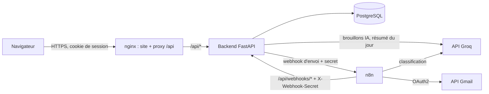

# Rapport : Inbox Assistant (Web, API et automatisation n8n)

🇫🇷 **Français** | 🇬🇧 [English version](REPORT.en.md)

## 1. Installation depuis un dépôt vierge

Les étapes complètes sont dans le [README.md](README.md). En résumé :

```bash
git clone <repo> && cd inbox-assistant
cp .env.example .env                       # renseigner les secrets
docker compose up -d --build               # db + backend + web + n8n
docker compose exec backend python -m scripts.seed --classify   # 30 e-mails de démonstration
# http://localhost:8080
```

Ensuite, pour brancher les vrais services : clé Groq, client OAuth Gmail, `python n8n/setup_n8n.py`, connexion Google dans n8n, activation des workflows (README, section « Going live »).

## 2. Architecture



Règles :
- **Le site n'appelle jamais n8n.** Il appelle uniquement `/api/*` sur sa propre origine. nginx bloque `/api/webhooks/*` depuis l'extérieur : seul n8n atteint ces routes, via le réseau Docker interne.
- **n8n n'écrit jamais dans la base.** Il appelle le backend, qui valide tout.
- **Chaque sens a son propre secret :** `WEBHOOK_SECRET` (n8n vers backend) et `N8N_WEBHOOK_SECRET` (backend vers n8n).

### Les quatre workflows

| Workflow | Déclencheur | Rôle |
|---|---|---|
| 1. Synchronisation Gmail | Toutes les 10 min | Récupère le curseur auprès du backend, liste Gmail avec `after:<curseur>` (toutes les pages), récupère chaque message (10 par seconde), l'analyse, envoie des lots de 20, clôt l'exécution de synchronisation |
| 2. Classification IA | Toutes les 5 min | Récupère les e-mails en attente avec un prompt prêt à l'emploi, appelle Groq, renvoie la réponse brute pour validation, réessaie une fois si elle est invalide, pause de 3 s entre deux e-mails |
| 3. Envoi des réponses | Webhook appelé par le backend | Réserve (« claim ») la tentative, construit le message MIME (même fil Gmail), l'envoie, renvoie `sent` ou `failed` |
| 4. Gestion des erreurs | Error Trigger | Enregistre tout plantage auprès du backend ; une synchronisation plantée est marquée en échec |

### Flux principaux

**Synchronisation.** Le curseur est l'heure de *début* de la dernière exécution *réussie*, moins un chevauchement de 5 minutes. Les e-mails arrivés pendant une exécution, ou un léger décalage d'horloge, sont donc récupérés à nouveau la fois suivante, et les doublons sont écartés grâce à l'identifiant Gmail unique. Une exécution échouée ou plantée ne fait jamais avancer le curseur : rien n'est perdu. La toute première synchronisation ne récupère que les 30 derniers jours.

**Classification.** Le backend construit le prompt (numéros de téléphone et IBAN masqués), n8n le transmet à Groq et renvoie le texte brut. Le backend le valide avec un schéma strict :
- Valide : enregistré.
- Invalide : le backend renvoie un prompt plus strict et n8n réessaie une fois.
- Encore invalide : catégorie `other` (autre), indicateur `needs_review` (« To verify » / à vérifier dans l'interface).
- Groq injoignable après ses nouvelles tentatives : l'e-mail reste simplement en attente pour l'exécution suivante ; un problème de quota n'est donc jamais confondu avec une mauvaise réponse.

**Réponse.** L'utilisateur voit et modifie le brouillon, clique sur *Review and send*, puis *Send now*. Le front crée une `Idempotency-Key` par validation. Le backend enregistre la réponse (clé unique), puis la transmet à n8n en tâche de fond. n8n doit **réserver** la tentative avant d'envoyer. L'interface interroge le statut de la réponse (en cours, envoyé, ou échec avec bouton Réessayer).

## 3. Modèle de données

```mermaid
erDiagram
    users ||--o{ auth_sessions : has
    threads ||--o{ emails : contains
    emails ||--o{ drafts : has
    emails ||--o{ replies : has
    drafts |o--o{ replies : "used for"

    users {
        int id PK
        string email UK
        string password_hash
    }
    auth_sessions {
        int id PK
        string token_hash UK
        int user_id FK
        datetime expires_at
    }
    threads {
        int id PK
        string gmail_thread_id UK
        string subject
        datetime last_message_at
    }
    emails {
        int id PK
        string gmail_message_id UK
        int thread_id FK
        string rfc822_message_id
        string from_address
        json to_addresses
        string subject
        text body_text
        datetime received_at
        bool is_outbound
        string status
        string category
        int priority
        text ai_summary
        text expected_action
        bool needs_review
        string classification_state
        int classification_attempts
        bool first_try_valid
    }
    drafts {
        int id PK
        int email_id FK
        string tone
        text body
        string model
    }
    replies {
        int id PK
        int email_id FK
        int draft_id FK
        string idempotency_key UK
        text body
        string status
        int attempts
        int claimed_attempt
        string gmail_message_id
        text error
    }
    sync_runs {
        int id PK
        datetime started_at
        datetime finished_at
        string status
        datetime cursor_from
        int fetched_count
        int inserted_count
        int duplicate_count
    }
    workflow_errors {
        int id PK
        string workflow
        string node
        text message
        string execution_id
    }
    daily_summaries {
        date day PK
        string fingerprint
        text text
    }
```



- `emails.status` : `to_process` (à traiter), `draft_ready` (brouillon prêt), `replied` (répondu), `ignored` (ignoré).
- `emails.category` : `client`, `invoice` (facture), `appointment` (rendez-vous), `newsletter`, `spam` (spam probable), `other` (autre).
- `emails.priority` : 1 = urgent, 2 = cette semaine, 3 = faible.
- `replies.status` : `sending` (en cours), `sent` (envoyé), `failed` (échec).
- Les e-mails envoyés par l'utilisateur (libellé Gmail `SENT`) sont stockés avec `is_outbound = true`. Ils apparaissent dans le fil, pas dans la liste de réception, et ils marquent les e-mails plus anciens du fil comme `replied`.

## 4. Choix techniques

| Choix | Raison |
|---|---|
| **PostgreSQL** plutôt que SQLite | Vraie concurrence (n8n et le site écrivent en même temps), contraintes `UNIQUE` fiables, et le même moteur qu'en production. Les tests tournent aussi sur SQLite pour la rapidité, et sur PostgreSQL pour vérifier le comportement réel. |
| **Idempotence dans la base** (`UNIQUE` sur `gmail_message_id` et `idempotency_key`) | Une vérification uniquement applicative échoue quand deux requêtes arrivent en même temps. La contrainte est la garantie finale ; le code intercepte le conflit et renvoie la ligne existante. |
| **Changements d'état atomiques** (`UPDATE ... WHERE status = 'failed'`) | Deux clics sur Réessayer ne peuvent pas lancer deux tentatives : un seul `UPDATE` correspond. |
| **Réservation avant envoi** (`claimed_attempt`) | Si le même envoi atteint n8n deux fois, seule la première exécution envoie. Si le backend dépasse son délai alors que n8n a bien reçu la requête, la tentative réservée n'est pas marquée en échec : l'utilisateur ne se voit pas proposer un « Réessayer » qui enverrait deux fois. |
| **Le backend gère le prompt et la validation** | Une seule source de vérité, données sensibles masquées avant de quitter le backend, et validation couverte par des tests unitaires Python. n8n reste un simple orchestrateur. |
| **Brouillons générés par le backend**, pas par n8n | L'utilisateur attend dans l'interface : un appel synchrone est plus simple et plus rapide. Le sujet liste exactement quatre workflows, et les brouillons n'en font pas partie. |
| **Top 5 par règles, résumé écrit par l'IA** | Le classement (priorité, puis « à vérifier », puis ancienneté) est prévisible et explicable : chaque élément affiche sa raison. L'IA écrit seulement le résumé en texte libre, mis en cache par jour. |
| **Deux modèles** | `openai/gpt-oss-20b` pour la classification (beaucoup d'appels, tâche simple, `temperature 0`, mode JSON, raisonnement court). `openai/gpt-oss-120b` pour les brouillons (peu d'appels, la qualité d'écriture compte). Les deux sont configurables dans `.env`. |
| **Cookie de session** (httpOnly, SameSite=Lax) + Argon2id | Le jeton n'est pas lisible par JavaScript (XSS), et seul son SHA-256 est stocké en base. Les mots de passe utilisent Argon2id, la recommandation actuelle de l'OWASP. |
| **Signature HMAC en plus du secret partagé** (bonus) | Le secret partagé prouve qui appelle ; le HMAC prouve en plus que le corps n'a pas été modifié en chemin. Dans n8n, un nœud Crypto signe le texte exact que le nœud HTTP suivant envoie comme corps brut ; la clé vient de `$env.WEBHOOK_HMAC_SECRET`, donc les exports de workflows ne contiennent aucune clé. |
| **Même origine** (nginx sert le site et relaie `/api`) | Pas de configuration CORS, et le cookie fonctionne simplement. |
| **FastAPI** | Modèles de requête et de réponse typés (Pydantic) et documentation Swagger automatique sur `/api/docs`. |
| **n8n figé en version 1.123.62** | La dernière branche 1.x maintenue. La 2.x change des valeurs par défaut (par exemple l'accès aux variables d'environnement dans les nœuds) dont ces workflows dépendent. |

## 5. Difficultés rencontrées et solutions

| Difficulté | Solution |
|---|---|
| Ne perdre aucun e-mail aux bords de la fenêtre de synchronisation | Curseur = début de la dernière exécution *réussie* moins 5 minutes de chevauchement. Le chevauchement crée volontairement des doublons, que l'import idempotent absorbe. |
| Gmail renvoie les messages du plus récent au plus ancien, mais les règles de statut des fils ont besoin de l'ordre chronologique | Le backend trie chaque lot par date avant de l'enregistrer. |
| L'IA ne renvoie pas toujours un JSON propre | Mode JSON de Groq + `temperature 0` + schéma strict (priorité `StrictInt`, liste fermée de catégories) + une nouvelle tentative avec un prompt plus strict + un repli sûr. Un bloc de code Markdown est toléré ; tout le reste est rejeté. |
| Distinguer « l'IA a répondu n'importe quoi » de « l'IA est injoignable » | Les erreurs de quota et de réseau passent par la sortie d'erreur du nœud HTTP et laissent l'e-mail en attente ; seule une vraie réponse compte comme une tentative. |
| Répondre dans le même fil Gmail | Enregistrer les en-têtes `Message-ID` et `References` lors de la synchronisation, puis envoyer avec `threadId` + `In-Reply-To` + `References` + un objet « Re: ». |
| Double envoi quand le réseau coupe au milieu | Clé d'idempotence + nouvelle tentative atomique + réservation avant envoi + « envoyé l'emporte sur échec » pour une même tentative. Aucune nouvelle tentative automatique sur l'envoi Gmail lui-même. |
| Aucun identifiant dans les exports de workflows | Les workflows ne référencent que des identifiants de credentials. `n8n/setup_n8n.py` lit `.env` et importe les credentials dans n8n, qui les chiffre. |
| Injection d'en-têtes dans l'e-mail sortant | Les retours à la ligne sont supprimés de chaque valeur d'en-tête avant de construire le message MIME. |
| Compteurs de synchronisation faux avec le vrai Gmail : une exécution indiquait 20 doublons au lieu de 30 | n8n envoie les lots d'une même exécution en parallèle, et le backend faisait `count += n` en Python (lecture, puis écriture) : un lot écrasait le compte de l'autre (« mise à jour perdue »). Les compteurs sont désormais incrémentés de façon atomique en SQL (`count = count + n`), et un test envoie 8 lots en parallèle sur PostgreSQL. Aucun e-mail n'a jamais été perdu, seulement le compte. |
| « Le serveur est injoignable » après la recréation du conteneur backend | nginx résout `backend` une seule fois au démarrage et gardait l'ancienne adresse IP du conteneur (HTTP 502). nginx utilise maintenant le DNS de Docker (`resolver 127.0.0.11`) avec une variable dans `proxy_pass`, donc le nom est résolu à nouveau ; vérifié en forçant le backend sur une nouvelle adresse IP. |
| Signer dans n8n sans divulguer la clé | Un nœud Crypto (HMAC-SHA256) lit la clé dans l'environnement, et le nœud HTTP envoie le corps sous forme de texte brut construit par la même expression : les octets signés sont exactement les octets envoyés. |
| Groq a retiré les modèles Llama choisis au départ (HTTP 404 `model_not_found`) | Passage à `gpt-oss-20b` / `gpt-oss-120b`. Les noms des modèles sont dans `.env` : aucun code n'en dépendait. |
| Les modèles `gpt-oss` « réfléchissent » avant de répondre, et ce raisonnement compte dans `max_tokens` : avec 300 tokens, certaines réponses étaient coupées avant le JSON (HTTP 400 `json_validate_failed` de Groq, 1 e-mail sur 28) | `reasoning_effort: low` pour ces modèles et un budget plus large (1000 tokens). Le taux de réponses valides du premier coup est passé de 96,4 % à 100 %. Comme n8n transmet sans la modifier la requête construite par le backend, la correction s'applique aussi au workflow. |

## 6. Résultats mesurés

> Mesures du 20 et 21/10/2026 sur une installation Docker locale (Windows 11, PostgreSQL 16, n8n 1.123.62), avec une boîte Gmail de test dédiée et Groq.

| Mesure | Méthode | Résultat |
|---|---|---|
| Durée de synchronisation de 30 e-mails (de Gmail à la base) | 30 e-mails envoyés à la boîte de test, puis une exécution du workflow 1 ; `duration_seconds` de cette exécution dans `GET /api/stats` | **9,7 s** pour 30 e-mails (30 récupérés, 30 insérés, 0 doublon ; exécution n° 8). L'exécution suivante a récupéré à nouveau les mêmes 30 grâce au chevauchement de 5 minutes : 11,4 s, 0 inséré, 30 doublons |
| Temps d'import backend pour 30 e-mails (lots de 10, PostgreSQL 16, local) | `python -m scripts.seed` | environ 0,07 s (mesuré en local ; la récupération Gmail domine le total) |
| Sorties IA valides du premier coup (jeu de démonstration, 28 e-mails reçus) | `python -m scripts.eval_classification` (affiche `valid_first_try_rate`) | **100 %** (28/28, sur 2 exécutions, `gpt-oss-20b`, mesuré le 20/10/2026) |
| Exactitude des catégories par rapport aux étiquettes attendues (jeu de démonstration) | même commande (`category_accuracy`) | **82 à 86 %** (23-24/28). Erreurs typiques : une relance de paiement lue comme `client`, des e-mails `other` limites lus comme `spam` ou `invoice` |
| Priorité (jeu de démonstration) | même commande (`priority_exact`, `priority_within_1`) | 71 % exacte, 89 % à un niveau près |
| Latence de l'IA | même commande (`mean_latency_s`) | environ 0,65 s par e-mail ; un brouillon prend moins d'1 s (`gpt-oss-120b`) |
| Sorties IA valides du premier coup (vraie boîte, via n8n) | `first_try_valid` des e-mails synchronisés depuis Gmail (`GET /api/stats` donne directement ce taux sur une boîte sans les données de démonstration) | **100 %** (30/30 e-mails synchronisés, 0 nouvelle tentative, 0 « à vérifier ») |
| Réponse envoyée depuis l'application (vrai Gmail) | envoi depuis l'interface, vérification du statut et du fil | statut `sent` environ 1 s après « Send now » ; la réponse apparaît dans le même fil Gmail |
| Gestion des erreurs (panne Gmail simulée) | API Gmail rendue injoignable pour n8n seulement, puis rétablie | La synchronisation planifiée a échoué après ses 3 tentatives ; le workflow 4 a enregistré l'erreur auprès du backend en moins de 10 s (workflow, nœud, message, identifiant d'exécution) et l'exécution a été marquée `failed`. L'exécution suivante est repartie du même curseur que celle en échec (dernière exécution réussie moins le chevauchement) : rien n'a été sauté |
| Vérification HMAC (en conditions réelles) | requêtes envoyées au backend en fonctionnement | signature absente, signature fausse et corps modifié après signature : tous refusés (HTTP 401) ; appels signés de n8n et du script de démonstration : acceptés |
| Tests automatisés | `pytest` | 63 sur PostgreSQL 16 ; sur SQLite, 62 réussis et 1 ignoré (le test des lots en parallèle a besoin de vraies connexions concurrentes) |

L'essentiel du temps de synchronisation vient de la récupération Gmail : le workflow récupère au plus 10 messages par seconde pour respecter le quota Gmail, donc 30 e-mails demandent environ 3 s de récupération pure ; le reste correspond au listage, aux allers-retours HTTP entre n8n et le backend, et au fonctionnement propre de n8n. L'import par le backend prend nettement moins de 0,1 s.

## 7. Limites et améliorations possibles

- **Échec Gmail ambigu.** Si Gmail accepte l'e-mail mais que n8n plante avant de le signaler, la réponse reste « en cours » (une tentative réservée n'est jamais passée en échec automatiquement). L'utilisateur doit vérifier le dossier Envoyés de Gmail. Amélioration : avant une nouvelle tentative, rechercher dans Gmail le `Message-ID` généré.
- **Migrations de schéma.** Les tables sont créées au démarrage (`create_all`). Pour un vrai déploiement, utiliser des migrations Alembic.
- **Recherche.** `ILIKE` sur l'objet et le contenu suffit pour quelques milliers d'e-mails. Au-delà, un index plein texte PostgreSQL (`tsvector` + GIN).
- **Un seul utilisateur.** Un compte, créé à partir de `.env`. Le multi-utilisateur demanderait un propriétaire sur les fils et des credentials Gmail par utilisateur.
- **Limitation des tentatives de connexion** non implémentée (ajouter une limite par IP et par compte).
- **Mises à jour en direct.** La liste se rafraîchit toutes les 60 s et le statut d'envoi toutes les 1,5 s pendant l'envoi. Les Server-Sent Events supprimeraient ces interrogations (bonus non réalisé).
- **Réponse automatique pour une catégorie (bonus).** Non implémentée, volontairement : envoyer sans validation est la fonctionnalité la plus risquée, et elle dépassait le temps disponible.
- **Déclenchement de la classification.** Le workflow 2 tourne toutes les 5 minutes ; le déclencher à la fin de chaque synchronisation réduirait le délai.
- **Priorité du spam probable.** Sur la vraie boîte, l'IA donne parfois la priorité 1 à des e-mails de type hameçonnage (par exemple un avis « votre domaine expire » classé `spam`, P1) : elle prend leur fausse urgence au sérieux. Le top 5 classe déjà le spam après les autres e-mails de même priorité, mais une règle simple (`spam` ou `newsletter` → priorité 3) rendrait cela cohérent.
- **Première synchronisation** limitée aux 30 derniers jours.
- **Langue de l'interface.** L'interface et les textes produits par l'IA sont en anglais ; le rapport existe en français et en anglais.

### État des bonus

| Bonus | État |
|---|---|
| Mises à jour en temps réel (SSE / WebSocket) | Non réalisé (interrogation périodique à la place) |
| Signature HMAC du corps des webhooks | Réalisé : chaque appel de n8n au backend est signé (HMAC-SHA256 du corps exact, en-tête `X-Signature`), et le backend refuse une signature absente, fausse ou un corps modifié |
| Masquage des numéros de téléphone et des IBAN avant l'IA | Réalisé et testé |
| Réponse automatique pour une catégorie | Non réalisé |
